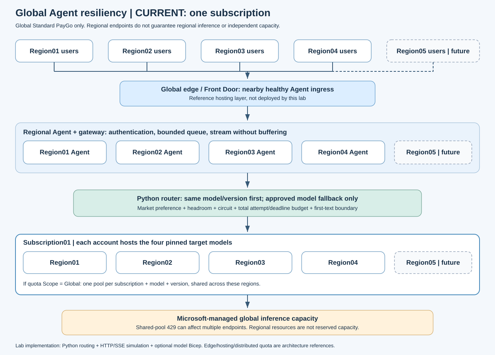

## 목적

PTU 없이 `GlobalStandard` PayGo를 사용하는 글로벌 Agent의 장애 대응을 검증합니다.
동일 모델·버전의 리전 전환과, 명시적으로 승인한 타 모델 전환을 분리합니다.
Region01, Region02, Region03, Region04 사용자와 향후 추가 지역 진출을 고려합니다.

> [!IMPORTANT]
> 이 프로젝트는 reference implementation입니다. 로컬 테스트는 실제 OpenAI Python SDK와
> 모의 HTTP/SSE를 사용합니다. 실제 Azure 장애, 처리량, 글로벌 사용자 TTFT를 검증한 결과가 아닙니다.
> 유료 배포나 실호출은 자동 실행하지 않습니다.

## 최신 검증 요약

2026-10-19에 현재 코드로 HTTP/SSE 장애 테스트를 다시 실행했습니다.
89개 기존 회귀 테스트에 모의 정책 시계 검증 2개를 추가했으며,
재실행 결과와 원시 JSON의 집계가 문서와 일치하는지 확인합니다.

| 구성 | HTTP/SSE 합계 조건 수 | 논리 요청 | 성공 응답 | 기대된 명시적 실패 |
|------|----------------------|-----------|-----------|--------------------|
| 단일 구독·4개 지역 | 160 | 1,600 | 968 | 632 |
| 가상 두 구독·각 4개 지역 | 224 | 2,240 | 1,680 | 560 |
| 합계 | 384 | 3,840 | 2,648 | 1,192 |

성공 수와 시나리오 합격 수는 다릅니다.
모든 후보 장애·인증 오류·예산 초과에서는 실패가 올바른 결과입니다.
실제 Azure 호출은 0회이며, 별도 구독·용량 독립성과 TTFT는 실환경 검증 대상입니다.
검증 명령과 환경은 [검증 기록](docs/verification.json)에 있습니다.

## Resiliency 적용 방법

요청을 보내기 전의 선제 제한, 장애 발생 시의 전환, 복구 후 재진입을 하나의 정책으로 적용합니다.
핵심은 무조건 재시도하는 것이 아니라 **보낼 수 있는 승인 후보에만, 정해진 시간과 횟수 안에서 요청하는 것**입니다.

| 단계 | 적용 방법 | 기대 효과 |
|------|-----------|-----------|
| 전송 전 | remaining/reset 헤더 기반 admission control | 관측된 잔여 예산을 넘는 요청을 미리 제한 |
| 후보 선택 | 동일 모델·고정 버전의 정상 지역 우선 | 불필요한 모델 변경 없이 endpoint 장애 대응 |
| 모델 전환 | allowlist와 요청 opt-in으로 승인된 fallback만 허용 | 모델 전체 장애 때 승인된 대체 모델 사용 |
| 재시도 | Retry-After 준수, 지수 backoff와 jitter | 과도한 재호출과 동시 재시도 집중 완화 |
| 장애 격리 | endpoint별 cooldown·circuit breaker | 장애 후보로 반복 전송하는 것을 제한 |
| 복구 | cooldown 만료 후 단일 half-open probe | 복구 여부를 확인한 후 정상 후보로 복귀 |
| 자원 보호 | backend별 동시성 및 전체 시도·시간 상한 | 과부하와 무한 재시도 방지 |
| 스트리밍 | 첫 텍스트 전까지만 전환, 이후 자동 재생 금지 | 중복 응답과 Agent 부작용 위험 완화 |

### 헤더 기반 선제적 요청 제한

[Microsoft 공식 rate-limit response headers 가이드](https://learn.microsoft.com/azure/foundry/openai/how-to/quota?tabs=python#rate-limit-response-headers)에 따라,
응답에서 잔여 요청·토큰 예산을 수집하고 **다음 API 호출 전에** 전송 가능 여부를 확인합니다.
429를 받은 뒤에만 동작하는 retry 정책과는 별도의 보호 계층입니다.

| 헤더 | 현재 구현의 처리 |
|------|------------------|
| `x-ratelimit-remaining-requests` | 잔여 요청이 0이면 해당 quota pool로 새 요청을 보내지 않음 |
| `x-ratelimit-remaining-tokens` | 잔여 토큰이 입력 추정 토큰 + 최대 출력 토큰보다 적으면 전송하지 않음 |
| `x-ratelimit-reset-requests` | 요청 예산의 제한 해제 시점 판단 |
| `x-ratelimit-reset-tokens` | 토큰 예산의 제한 해제 시점 판단 |
| `retry-after-ms` / `Retry-After` | 일시 오류 발생 시 서버가 지정한 재시도 대기시간을 준수 |

예를 들어 잔여 토큰이 29개이고 다음 요청의 입력 추정치가 10개, 최대 출력이 20개이면
필요 예산 30개를 확보할 수 없으므로 해당 후보를 호출하지 않습니다.
같은 모델의 다른 정상 후보를 먼저 확인하고, 허용된 경우에만 승인된 타 모델로 전환합니다.
모든 후보가 제한 중이면 deadline 안에서 reset을 기다리거나 `RoutingExhausted`로 명시적으로 실패합니다.

전송할 요청은 예산을 미리 차감하여 동시 요청끼리 같은 잔여량을 중복 사용하지 않도록 합니다.
같은 `quota_pool`을 공유하는 지역은 예산도 공유하므로, 지역만 바꿔 같은 quota를 우회하지 않습니다.
같은 시간 창에서 늦게 도착한 큰 remaining 값으로 이미 줄인 예산을 다시 늘리지 않습니다.
remaining은 있지만 유효한 reset이 없으면 경고 후 60초간 보수적으로 유지합니다.
헤더가 없으면 잔여 예산을 예측할 수 없으므로 동시성 제한과 실제 오류 관측을 사용합니다.

이 동작은 [라우터 구현](src/foundry_resiliency/router.py)과
[헤더·공유 quota 회귀 테스트](tests/test_router.py)에서 확인할 수 있습니다.
아래 결과의 `headroom` 시나리오가 HTTP/SSE 경로의 선제 제한을 검증합니다.

### 동일 모델 우선 전환과 승인된 타 모델 전환

동일 모델 모드는 요청한 모델 ID와 고정 버전을 유지하면서 정상 지역 후보를 선택합니다.
혼합 모델 모드는 요청 모델의 후보들이 제한되거나 실패했을 때 다음 모델 그룹을 검토합니다.
설정의 `fallbacks`와 요청의 `allow_model_fallback=True`가 모두 있어야 타 모델을 사용합니다.

전환된 응답은 `requested_model`, `selected_model`, `selected_version`, `degraded`를 기록합니다.
대체 모델 응답을 원래 모델의 응답으로 위장하지 않습니다.
모델별 기능·업무 품질·데이터 처리 범위는 별도로 승인해야 합니다.
자세한 구성은 [동일 모델·혼합 모델 아키텍처](docs/architecture.md)를 참고하세요.

### 재시도 상한과 circuit breaker

재시도 대상은 429, 408, 500, 502, 503, 504 및 연결·timeout 오류입니다.
400, 401, 403, 404, 422, 501 같은 오류나 안전성 거절은 다른 모델로 숨기지 않습니다.
유효한 서버 대기시간을 로컬 backoff 상한으로 줄이지 않으며,
즉시 사용할 수 있는 다른 승인 후보가 있으면 제한 중인 endpoint를 기다리는 대신 선택합니다.

일시 오류가 반복되면 circuit을 열어 해당 endpoint를 제외하고,
설정된 시간이 지난 뒤 하나의 probe만 허용합니다.
probe가 성공하면 정상 후보로 복귀하고, 실패하면 다시 차단합니다.
OpenAI SDK는 `max_retries=0`으로 설정하여 SDK와 application의 재시도가 중첩되지 않도록 합니다.

### 동시성·시간 예산과 스트리밍 보호

[기본 설정](src/foundry_resiliency/config.py)과 [예제 생성기](src/foundry_resiliency/examples.py)의 값은 다음과 같습니다.
고객 SLO가 아니라 실환경 측정 후 조정해야 하는 시작값입니다.

| 보호 항목 | 기본값 또는 예제값 |
|-----------|--------------------|
| backend별 동시 처리 상한 | 4개 |
| 전체 첫 응답 deadline | 8초, 비스트리밍은 응답 완료까지 |
| 비스트리밍 attempt 제한 | 3초 |
| 스트리밍 attempt의 첫 텍스트 제한 | 2초 |
| 첫 텍스트 이후 stream context 제한 | 60초 |
| 전체 시도 상한 | 동일 모델 예제 4회, 혼합 모델 예제 16회 |
| circuit 진입 기준·최소 차단시간 | 일시 오류 2회, 10초. 서버 대기시간이 더 길면 그 시간을 준수 |

SSE의 `response.created`, keepalive나 빈 chunk는 첫 토큰으로 계산하지 않습니다.
첫 non-empty 텍스트 delta를 노출하기 전까지만 자동 전환할 수 있습니다.
첫 텍스트 이후 stream이 끊기면 호출자에게 오류를 전달하고 다른 endpoint에서 자동 재생하지 않습니다.
stream이 닫힐 때까지 동시성 slot을 유지합니다.

지역 선호 후보 선택과 연결·인증 token 재사용도 적용합니다.
실제 TTFT 개선에는 prompt/RAG 크기, proxy buffering, Agent 검색·tool 시간과 사용자 네트워크까지
함께 측정해야 하며, 자세한 기준은 [TTFT 가이드](docs/latency.md)에 있습니다.

### 운영 적용 시 경계

헤더 기반 선제 제한은 관측한 예산을 활용하는 방법이지 모든 429를 예방하는 보장이 아닙니다.
Global Standard shared-pool 용량 변화나 burst, 토큰 추정 오차로 429가 여전히 발생할 수 있습니다.
또한 현재 admission·circuit 상태는 프로세스 내부 기준이므로,
여러 Agent replica의 공유 limiter, 사용자별 공정성, bounded ingress queue는 별도 운영 구현이 필요합니다.
APIM을 함께 사용하더라도 retry 소유 계층을 하나로 정해야 합니다.
[운영 가이드](docs/operations.md)와 아래 한계 항목을 함께 확인하세요.

## 장애 주입 테스트 결과

2026-10-19에 네 모델을 각각 요청 모델로 사용하여 검증했습니다.
실제 Python router와 OpenAI SDK를 호출하고, SDK 아래 HTTP/SSE 계층에서 장애를 주입했습니다.
고정된 성공 수를 출력하는 mock router가 아니라, 실제 선택된 backend와 wire attempt를 기록합니다.
성공은 HTTP 200뿐 아니라 완성된 응답의 `OK` 텍스트 또는 SSE 텍스트·완료 이벤트까지 확인합니다.

| 검증 항목                     | 관측 결과                     |
|-------------------------------|-------------------------------|
| 요청 모델                     | 4개 모두 검증                 |
| 지역 표기                     | Region01~Region04             |
| 장애 조건                     | 10개, 동일/혼합 모델 구분     |
| 전체 회귀 테스트              | 91개 통과                     |
| HTTP / SSE 시나리오           | 각각 80개, 합계 160개 합격    |
| 논리 요청                     | 각각 800개, 합계 1,600개      |
| 성공 응답                     | 합계 968개                    |
| 기대된 명시적 실패            | 합계 632개                    |
| 실제 Azure 모델 호출          | 0개                           |

모든 요청 성공을 주장하는 테스트가 아닙니다.
살아 있는 승인 후보가 있으면 전환하고, 없거나 전환하면 안 되는 경우에는 제한된 시도 안에서 실패하는지 검증합니다.
`passed=true`는 해당 조건의 기대 결과를 충족했다는 뜻입니다.

### 모델 전체 장애에서의 연속 응답

아래 숫자는 HTTP 10회 + SSE 10회로, 각 모델·장애 조건마다 20회입니다.
모두 혼합 모델 allowlist와 요청 opt-in을 활성화했습니다.

| 요청 모델        | 전체 endpoint 429 | 전체 endpoint 503 | 요청 모델과 첫 fallback 모두 429 | 429/503 때 선택된 모델 |
|------------------|-------------------|-------------------|---------------------------------|------------------------|
| gpt-6.1-sol      | 20/20             | 20/20             | 20/20                           | gpt-6-luna             |
| gpt-6-luna       | 20/20             | 20/20             | 20/20                           | gpt-6.1-sol            |
| gpt-5.6-terra    | 20/20             | 20/20             | 20/20                           | gpt-6.1-sol            |
| gpt-5.6-luna     | 20/20             | 20/20             | 20/20                           | gpt-6.1-sol            |

이 세 장애 조건에서 합계 **240/240 응답 성공**을 확인했습니다.
이는 시연용 fallback 순서이며 모델 간 업무 품질의 동등성이나 production 가용성을 보장하지 않습니다.
실제 적용 시 고객 평가를 통과한 전환 방향만 허용해야 합니다.

`gpt-6.1-sol` 전체 endpoint에 429를 주입했을 때 첫 요청의 실제 경로입니다.

```text
gpt-6.1-sol / Region01 : 429
gpt-6.1-sol / Region03 : 429
gpt-6.1-sol / Region04 : 429
gpt-6.1-sol / Region02 : 429
gpt-6-luna  / Region01 : 200, output=OK, degraded=true

이어지는 9개 요청:
gpt-6-luna / Region01 : 200, 각 1회 attempt
```

장애 endpoint의 cooldown을 기억하므로 매 요청마다 네 곳을 다시 두드리지 않았습니다.
요청 모델과 첫 fallback 모델이 모두 막힌 시나리오에서는 8개의 429 후
두 번째 fallback에서 성공했으며, 이후 요청은 그 정상 모델로 직접 전환했습니다.

### 성공과 안전한 실패를 함께 확인

각 셀은 네 모델 × HTTP/SSE × 10회에 대한 성공 수/요청 수입니다.

| 조건 | 동일 모델 모드 | 혼합 모델 모드 | 확인한 동작 |
|------|----------------|----------------|-------------|
| `healthy` | 80/80 | 80/80 | 정상 응답 |
| `region_429` | 80/80 | 80/80 | 다른 지역의 동일 모델 우선 |
| `same_model_429` | 0/80 | 80/80 | 승인된 타 모델로 전환 |
| `same_model_503` | 0/80 | 80/80 | 모델 전체 장애에도 타 모델 응답 |
| `fallback_model_429` | 0/80 | 80/80 | 첫 fallback도 장애이면 다음 모델 사용 |
| `correlated_429` | 0/80 | 0/80 | 모든 후보 장애는 명시적 실패 |
| `primary_503` | 80/80 | 80/80 | 동일 모델의 정상 지역 사용 |
| `primary_timeout` | 80/80 | 80/80 | 연결 timeout 후 정상 후보 사용 |
| `auth_401` | 0/80 | 0/80 | 한 번 시도 후 중단, 권한 오류 은폐 금지 |
| `headroom` | 8/80 | 80/80 | 공유 quota headroom 소진 후 승인 모델 전환 |

`headroom`의 동일 모델 모드는 모델·protocol마다 첫 요청만 성공한 뒤 같은 quota pool을 차단합니다.
같은 구독의 공유 quota를 다른 지역으로 옮겨 우회했다고 잘못 판단하지 않습니다.
전체 모델 장애 때는 가용성을 보장할 수 없으며, 실패를 명시적으로 반환하는 것이 올바른 결과입니다.

전체 요청별 trace와 검증 당시 정책은
[HTTP 결과 JSON](docs/results/resilience-http.json)과
[SSE 결과 JSON](docs/results/resilience-sse.json)에 있습니다.
테스트는 동일 모델 4회/혼합 모델 16회 총 시도 상한, 첫 응답 deadline 15초,
attempt/첫 텍스트 제한 10초, 60초의 고정 cooldown을 사용했습니다.
이는 장애 전환 논리를 분리해 확인하기 위한 실험 설정입니다.
정책 판단은 가상 시계를 사용하고, 실제 라우터의 timeout·deadline 동작은 별도 회귀 테스트로 검증합니다.
JSON의 `timing_mode`는 `virtual_policy_clock`이며 `first_token_ms`는 모의 정책 시간입니다.
`elapsed_ms`는 호스트에서 전체 실험을 수행한 시간이므로 실제 모델 TTFT나 복구 시간과 다릅니다.
일반 예제의 8초 deadline·2초 first-token 설정이나 실제 Azure TTFT 성능을 검증한 수치가 아닙니다.
시뮬레이션의 응답 시간으로 production latency SLO를 주장하지 않습니다.

## 실제 구독 없이 두 구독을 가정한 테스트

실제 Azure 구독이 하나여도 아래 테스트를 실행할 수 있습니다.
`Subscription01`, `Subscription02`는 Azure에 생성하는 구독이 아니라 모의 backend의 논리 그룹입니다.
각 구독에 같은 `Region01`~`RegionN`을 두고 네 모델을 각각 배치합니다.
N=4이면 **2개 가상 구독 × 4개 지역 × 4개 모델 = 32개 backend**입니다.
가입·로그인·권한 부여·유료 배포 없이 실제 router와 SDK의 모의 HTTP/SSE 경로만 실행합니다.

### 실행 방법과 가정

```powershell
# 두 가상 구독, 각 Region01~Region04, HTTP와 SSE를 각각 검증합니다.
uv run python -m foundry_resiliency simulate --subscriptions 2 --regions 4 --count 10 `
  --output artifacts\two-subscriptions-http.json
uv run python -m foundry_resiliency simulate --subscriptions 2 --regions 4 --stream --count 10 `
  --output artifacts\two-subscriptions-sse.json

# N을 변경합니다. 예: 각 구독에 Region01~Region08
uv run python -m foundry_resiliency simulate --subscriptions 2 --regions 8 --stream --count 3 `
  --output artifacts\two-subscriptions-n8.json

# 가상 구성 자체를 확인하려면 예제를 생성합니다. Azure 리소스를 생성하지 않습니다.
uv run python -m foundry_resiliency example --mode mixed --subscriptions 2 --regions 4 `
  --output configs\two-subscriptions.local.json
```

`--regions N`은 1~16을 지원합니다. 이 상한은 로컬 lab의 자원 보호를 위한 값이지 Azure 제한이 아닙니다.
구독 수를 생략하면 기존 단일 구독 테스트를 유지합니다.
명시적 `--regions`와 기존 `--include-expansion`은 동시에 사용하지 않습니다.
[두 구독 예제 설정](configs/two-subscriptions.example.json)도 제공합니다.

테스트에서는 같은 구독의 동일 모델·버전이 모든 지역에서 하나의 quota pool을 공유하고,
다른 구독의 quota pool은 별도로 관리된다고 가정합니다. 네 모델 × 두 구독이므로 예산 풀은 8개입니다.
실제 quota Scope는 [공식 가이드](https://learn.microsoft.com/azure/foundry/foundry-models/quotas-limits#check-quota-management-scope)에 따라
모델·구독별로 확인해야 하며, 별도 quota가 독립된 shared capacity를 뜻하지는 않습니다.

### 2026-10-19 가상 두 구독 검증 결과

N=4, 네 모델 × 동일/혼합 모드 × 14개 조건 × 10회씩 HTTP/SSE 양쪽을 실행했습니다.
각 protocol에서 112개 조건과 1,120개 요청을 검증했고,
합계 **224개 조건, 2,240개 요청 중 1,680개 성공과 560개 기대된 실패**를 확인했습니다.
이 결과는 앞의 단일 구독 실험과 별도이며, 실제 Azure 호출은 0개입니다.
기존 기능을 포함한 회귀 테스트 91개와 lint·타입 검사·패키지 빌드도 통과했습니다.

아래 표의 각 행은 네 모델 × 두 routing 모드 × HTTP/SSE × 10회에 대한 결과입니다.

| 구독 단위 주입 조건 | 시나리오 ID | 성공/요청 | 확인한 동작 |
|---------------------|-------------|-----------|-------------|
| Subscription01의 모든 endpoint 429 | subscription_429 | 160/160 | Subscription02의 동일 모델 사용 |
| Subscription01의 모든 endpoint 503 | subscription_503 | 160/160 | Subscription02의 동일 모델 사용 |
| Subscription01의 요청 모델 잔여 요청 0 | subscription_request_headroom | 160/160 | 다음 요청부터 Subscription02 사용 |
| Subscription01의 요청 모델 잔여 토큰 부족 | subscription_token_headroom | 160/160 | 429를 기다리지 않고 다음 요청부터 Subscription02 사용 |
| 두 구독의 모든 후보 429 | correlated_429 | 0/160 | 성공으로 위장하지 않고 명시적 실패 |

앞의 네 구독 전환 조건에서 **640/640 응답 성공**을 확인했으며 모델 변경은 없었습니다.
요청 모델 자체가 양쪽 구독에서 모두 장애이면, 기존과 같이 승인된 타 모델만 fallback합니다.
각 요청의 결과에는 `selected_subscription`과 시도별 `subscription`이 기록됩니다.

```text
429 장애 요청:
Subscription01 / Region01 / gpt-6.1-sol : 429
Subscription02 / Region01 / gpt-6.1-sol : 200, degraded=false

요청 또는 토큰 headroom 부족:
첫 요청  : Subscription01 / Region01 / gpt-6.1-sol : 200, 부족 헤더 관측
다음 요청: Subscription02 / Region01 / gpt-6.1-sol : 200, 단일 attempt
```

원시 결과는 [두 구독 HTTP JSON](docs/results/two-subscriptions-http.json)과
[두 구독 SSE JSON](docs/results/two-subscriptions-sse.json)에 저장했습니다.
이는 별도 예산 풀이라는 **가정 아래 routing·격리 동작을 검증한 결과**입니다.
실제 cross-subscription RBAC, quota 승인량, capacity 독립성, 네트워크 장애나 TTFT를 검증하지 않습니다.

### 후보 수와 재시도 예산

예제의 전체 시도 상한은 동일 모델이면 `min(20, 구독 수 × N)`,
혼합 모델이면 `min(20, 구독 수 × N × 모델 수)`입니다.
지역을 늘려도 정상 후보에 도달하기 전 시도 상한이나 deadline이 끝나면 요청은 실패합니다.

N=8에서 요청 모델과 첫 fallback 모델을 모두 429로 막은 실험에서는
첫 요청이 20회 후 `attempt_budget`으로 실패했습니다.
같은 router의 후속 요청은 이미 cooldown 중인 후보를 피하여 13회, 다음 요청은 1회 만에 성공했습니다.
이는 앞선 요청의 성공을 소급 보장하는 것이 아닙니다.
N=16의 같은 조건에서는 테스트한 첫 두 요청 모두 20회 상한으로 실패했습니다.
후보 수만 늘리면 가용성이 보장된다는 식으로 해석하면 안 됩니다.

## 읽는 순서

1. [2026년 리서치와 Top 3](docs/research.md)
2. [동일 모델·혼합 모델 및 다중 구독 아키텍처](docs/architecture.md)
3. [글로벌 사용자 TTFT 설계와 측정](docs/latency.md)
4. [Azure 구성·권한·운영 절차](docs/operations.md)
5. [테스트 범위와 재현 절차](docs/testing.md)
6. [고객 공유용 요약](docs/customer-summary.md)



SVG 4종은 Segoe UI·Arial·sans-serif에서 박스 내부 여백, 글자 겹침과 캔버스 경계를 확인했습니다.
줄바꿈과 라벨 간격을 조정했으며, 검증 범위는 [테스트 가이드](docs/testing.md)에 정리했습니다.

[다중 구독 SVG](docs/diagrams/global-multi-subscription.svg)는 향후 확장 참고안입니다.
기본값은 단일 구독이며, 두 구독의 가상 테스트를 지원합니다.
실제 추가 구독 생성·배포는 여전히 보류합니다.

## 지원 모델

조사일의 공식 Global Standard 지역 가용성 표 기준입니다.
모델 ID와 Azure deployment name은 서로 다릅니다. 호출에는 설정의 `deployment`를 사용합니다.

| 모델 ID        | 고정 버전   |
|----------------|-------------|
| gpt-6.1-sol    | 2026-09-29  |
| gpt-6-luna     | 2026-09-22  |
| gpt-5.6-terra  | 2026-07-09  |
| gpt-5.6-luna   | 2026-07-09  |

지원 표에 있어도 고객 구독의 quota, capacity, 모델 접근 승인까지 보장되지는 않습니다.
[공식 지역 가용성](https://learn.microsoft.com/azure/foundry/foundry-models/concepts/models-sold-directly-by-azure-region-availability#global-standard)을 배포 전에 다시 확인하세요.

## 빠른 실행

Python 3.11 이상과 [uv](https://docs.astral.sh/uv/)를 사용합니다. 다음은 Windows PowerShell 명령입니다.

```powershell
uv sync
uv run python -m foundry_resiliency simulate --count 10 --output artifacts\resilience-http.json
uv run python -m foundry_resiliency simulate --stream --count 10 --output artifacts\resilience-sse.json
uv run python -m pytest -q
uv run ruff check src tests
uv run ruff format --check src tests
uv run mypy src
```

시뮬레이션은 네 모델 × 동일/혼합 두 모드 × 10개 장애 조건을 각각 검증합니다.
`--subscriptions 2`에서는 구독 단위 4개 조건을 추가하여 protocol마다 112개 조건을 검증합니다.
`passed`는 장애 조건별 기대 동작을 만족했다는 의미입니다.
전체 용량 풀 장애에서는 성공 응답이 아니라 제한된 시간 내 명시적인 실패가 정답입니다.

## 예제 설정

[단일 구독 동일 모델 설정](configs/same-model.example.json)과
[혼합 모델 설정](configs/mixed-model.example.json)은 4개 리전과 4개 모델을 포함합니다.
모든 endpoint와 ARM resource ID는 교체해야 하는 예시입니다.
`region`은 별칭이며, 실제 지역 검증에 필요한 `azure_location`은 로컬 설정에 따로 입력합니다.
혼합 예제의 fallback 순서는 기능 시연용이며 고객 업무 품질 승인을 의미하지 않습니다.

```powershell
uv run python -m foundry_resiliency validate-config --config configs\same-model.example.json
uv run python -m foundry_resiliency example --mode mixed `
  --output configs\single-subscription.local.json
```

타 모델 전환에는 설정 allowlist와 요청의 `allow_model_fallback=True`가 모두 필요합니다.
CLI에서는 `--allow-model-fallback`으로 요청 단위 승인을 표현합니다.

## 반드시 알아둘 한계

* Global Standard의 리소스 리전은 실제 추론 수행 리전의 보장이 아닙니다.
* 서로 다른 리소스·리전·구독이 독립된 글로벌 용량 풀이라는 보장은 없습니다.
* 2026년 신규 quota 체계에 편입된 모델은 같은 구독의 모든 리전에서
  동일 모델·버전의 Global Standard quota를 공유합니다. Foundry Quota의 `Scope`를 확인하세요.
* 일부 기존 모델은 여전히 subscription/region/model/deployment-type 범위입니다.
  리전 수를 TPM 배수로 계산하지 마세요.
* 다중 구독은 별도 승인 quota 활용에 도움이 되지만 shared-pool throttling 해결을 보장하지 않습니다.
  문서의 usage-tier latency 기준은 tenant 전체의 모델 사용량을 합산합니다.
* 라우터의 headroom과 circuit state는 프로세스 내부 상태입니다.
  운영 다중 replica에는 공유 admission budget과 지역별 ingress 제한을 별도 구현해야 합니다.
* 텍스트 Responses API만 구현합니다. Tools, 이미지, 오디오, 서버측 conversation,
  Agent thread 이전, exactly-once 실행은 구현하지 않습니다.
* 첫 텍스트 delta 이후에는 stream을 다른 모델·리전으로 자동 재생하지 않습니다.
* 토큰 사전 추정은 admission 보조 수단이며 Azure의 rate-limit 계산을 정확히 복제하지 않습니다.

## Azure 실환경 실행

유료 리소스 생성은 [Bicep 템플릿](infra/main.bicep)을 검토한 후 별도로 수행합니다.
기존 배포가 있으면 [운영 가이드](docs/operations.md)의 권한 및 네트워크 점검을 먼저 진행합니다.

```powershell
uv run python -m foundry_resiliency preflight --config configs\single-subscription.local.json
uv run python -m foundry_resiliency smoke --config configs\single-subscription.local.json `
  --model gpt-6.1-sol --market Region01 --stream --count 5 --confirm-paid `
  --output artifacts\live-region01-sol.json
```

`smoke`는 ARM SKU·모델·버전·리전·endpoint 일치 확인 후 소량의 실제 요청을 보냅니다.
이는 글로벌 부하 테스트가 아닙니다. 실제 TTFT는 각 국가의 probe에서 반복 측정해야 합니다.

## 저장소 범위

코드는 [Python 패키지](src/foundry_resiliency/), 검증은 [tests](tests/),
설정은 [configs](configs/), 배포 템플릿은 [infra](infra/)에 있습니다.
외부 참고 repo의 소스를 복제하지 않고 패턴을 참고해 작성했습니다.
별도 GitHub repository 생성·게시나 기존 상위 저장소의 커밋은 자동 수행하지 않습니다.
