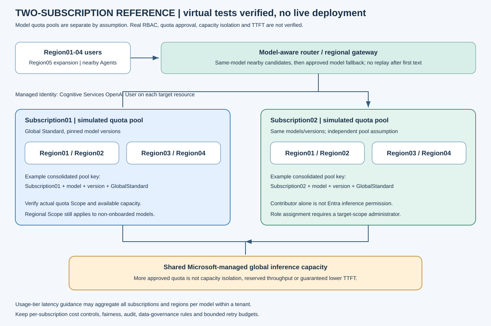
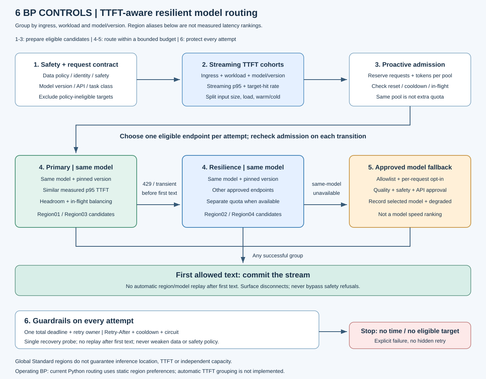
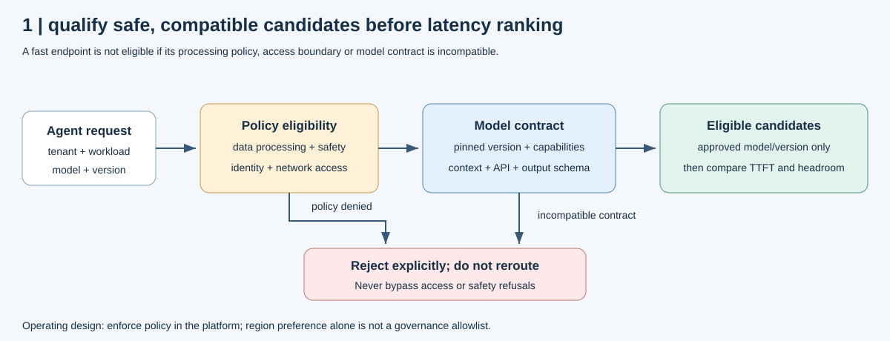
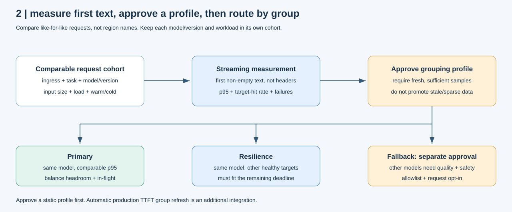
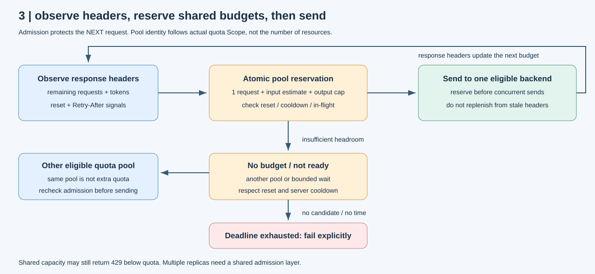
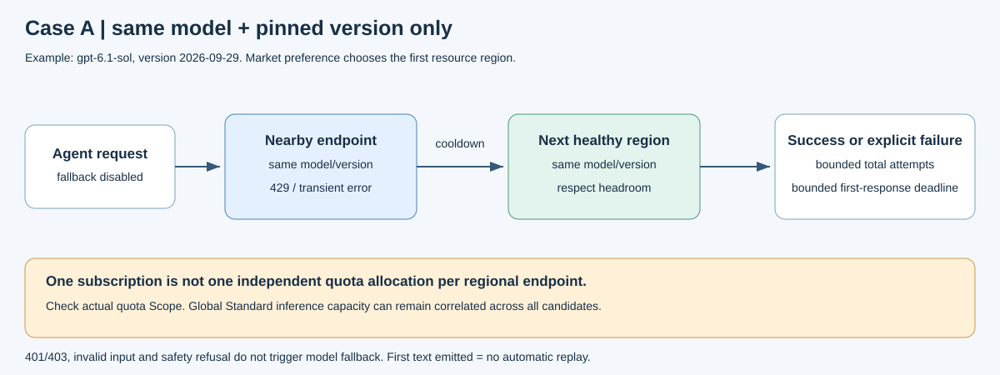
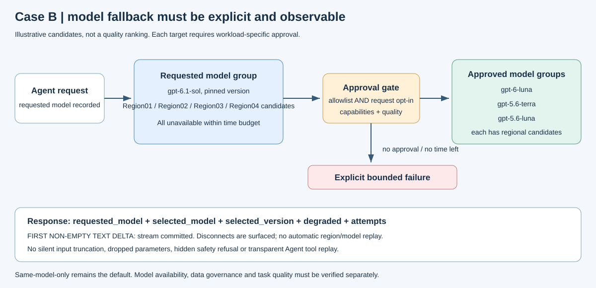
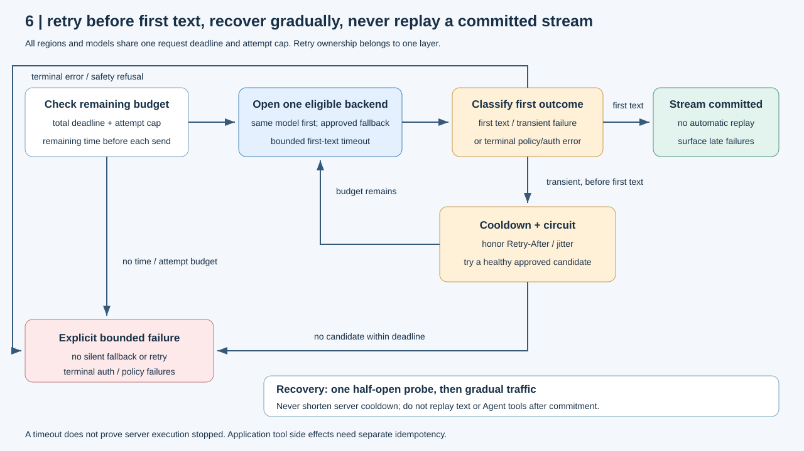

## BP 아키텍처 요약

Azure Foundry `GlobalStandard` PayGo 모델을 여러 구독·리전에 구성하고,
요청 예산과 endpoint 상태를 기준으로 정상 후보를 선택하는 Best Practice(BP)입니다.
Region01-RegionN의 글로벌 Agent가 한 배포의 throttling이나 장애 때문에 함께 중단되지 않도록,
**선제적 요청 제한 → 동일 모델 전환 → 승인된 대체 모델 전환 → 점진적 복구**를 일관된 정책으로 적용합니다.

## TL;DR: 핵심 방안 6가지

**안전한 후보만 남기고, 비슷하게 빠른 동일 모델에 분산한 뒤, 장애 시 제한된 시간 안에서 전환합니다.**
각 방안을 클릭하면 같은 번호의 상세 설명으로 이동합니다.

| 번호 | 핵심 방안 | 한 줄 실행 기준 | 기대 효과 |
|------|-----------|-----------------|-----------|
| 1 | [안전성 및 요청 분류](#1-안전성-및-요청-분류) | 데이터 정책·모델 계약·업무 유형으로 후보 제한 | 빠르지만 부적합한 endpoint 제외 |
| 2 | [Streaming TTFT 그룹핑](#2-streaming-ttft-그룹핑) | 사용자·업무·모델별 실측 p95와 목표 내 응답률로 그룹 구성 | 거리 대신 체감 성능 기준으로 선택 |
| 3 | [헤더 기반 선제적 요청 제한](#3-헤더-기반-선제적-요청-제한) | 잔여 요청·토큰 선예약, 동급 후보에 분산 | 429 발생 전 보호와 쏠림 완화 |
| 4 | [동일 모델 및 구독 전환](#4-동일-모델-및-구독-전환) | 다른 정상 endpoint·승인 quota의 같은 모델·버전 사용 | 품질 변경 없이 응답 연속성 확보 |
| 5 | [승인된 다른 모델로 fallback](#5-승인된-다른-모델로-fallback) | 품질·안전성 승인과 요청 opt-in을 모두 확인 | 모델 전체 장애의 영향 완화 |
| 6 | [시간 예산과 재시도 및 복구](#6-시간-예산과-재시도-및-복구) | 전체 deadline·retry 상한·circuit, 첫 텍스트 후 replay 금지 | 재시도 증폭·중복 응답·복구 집중 방지 |

바로 보기: [전후 TTFT·성공률 비교](#적용-전후-ttft와-응답-성공률) ·
[운영 KPI](#고객-환경에서-관리할-운영-kpi) · [실행 방법](#구성과-확인-방법) ·
[상세 가이드](#상세-가이드와-공식-근거)

## 권장 BP 아키텍처



Subscription01·02 각각에 Region01-RegionN의 모델 배포를 두고,
지역별 gateway 또는 application router가 공통 정책으로 호출 대상을 선택합니다.
정책은 중앙에서 관리하되 요청 처리는 지역별로 분산하여 중앙 gateway 한 곳으로의 왕복을 줄입니다.

| 구성 요소 | 역할 | 운영 설계 포인트 |
|-----------|------|------------------|
| 글로벌 진입점 | 가까운 정상 Agent 서비스로 연결 | Front Door 등으로 Agent/gateway 상태 기반 라우팅 |
| 지역별 gateway | 인증·사용자 공정성·접근 정책 적용 | APIM의 적합한 HA 구성, Managed Identity, 네트워크 통제 |
| 모델 router | 모델·버전·지역·quota 상태에 따라 후보 선택 | 동일 모델 우선, 승인된 fallback, 하나의 retry 소유 계층 |
| 공유 admission 계층 | 여러 replica의 요청·토큰 예산 조정 | 실제 quota Scope에 맞는 원자적 선예약, 제한된 대기열 |
| Foundry 모델 pool | 여러 endpoint와 승인된 quota 활용 | 구독별 quota·접근 승인 확인, 모델·버전 pinning |
| 관측 계층 | 사용자 영향과 전환 효과 확인 | 국가 대신 지역 별칭으로 TTFT·429·시도 수·비용 분리 |

구독을 늘리는 목적은 별도 승인 quota와 전환 후보를 활용하는 것입니다.
같은 구독의 리전 수를 TPM 배수로 계산하지 않습니다.
모델별 Foundry Quota의 `Scope`가 `Global`이면 같은 구독·모델·버전이 모든 리전에서 quota를 공유하고,
지역 Scope인 경우에는 해당 지역 범위를 기준으로 예산을 관리합니다.
[공식 quota Scope 가이드](https://learn.microsoft.com/azure/foundry/foundry-models/quotas-limits#check-quota-management-scope)를 적용 전에 확인합니다.

## 6가지 방안의 호출 흐름



그림의 1-6은 요약 표와 아래 상세 설명의 번호입니다.
1-3으로 후보를 준비하고, 4의 동일 모델 Primary·Resilience 다음에 5의 승인 fallback을 검토합니다.
6의 시간 예산·안전성·복구 규칙은 모든 시도에 공통 적용합니다.
실측 그룹은 운영 설계이며, 현재 Python router의 자동 TTFT 학습 기능을 뜻하지 않습니다.

## 1. 안전성 및 요청 분류

**속도 순위를 정하기 전에 호출해도 되는 후보부터 확정합니다.**



| 확인 항목 | 실행 기준 |
|-----------|-----------|
| 데이터·접근 정책 | 허용된 처리 범위, identity·네트워크와 content safety 조건 충족 |
| 모델 계약 | 모델·고정 버전, context와 필요한 API·기능의 호환성 확인 |
| 업무 분류 | 사용자 접점·짧은 대화/긴 추론·입력 길이·cache 조건 구분 |

같은 모델·버전의 전환과 다른 모델로의 품질 변경을 분리합니다.
안전성 거절을 다른 모델로 우회하거나, 빠른 endpoint를 쓰기 위해 데이터 처리 정책을 완화하지 않습니다.
지역 선호도는 데이터 거버넌스 allowlist를 대신하지 않습니다.

## 2. Streaming TTFT 그룹핑

**리전 이름이 아니라 같은 조건에서 측정한 첫 유효 텍스트의 속도와 안정성으로 그룹을 구성합니다.**



| 호출 그룹 | 구성 기준 | 호출 전략 |
|-----------|-----------|-----------|
| Primary | 동일 모델·버전 중 업무별 p95 TTFT와 목표 내 응답률을 만족하는 정상 후보 | 유사 성능 후보에 quota headroom·동시성을 반영해 분산 |
| Resilience | 다른 승인 endpoint의 동일 모델·버전, 가능하면 별도 승인 quota pool | 429·일시 장애 시 남은 시간 예산 내 전환 |
| Approved fallback | 업무 품질·안전성·API 계약을 승인한 다른 모델 | 요청 opt-in과 남은 시간 예산을 모두 만족할 때만 전환 |

* 사용자 접점 × 업무 × 모델·버전별로 측정하고, 입력 길이·부하·cache warm/cold를 구분합니다.
* Global Standard의 리소스 리전은 실제 추론 위치를 고정하지 않습니다. 가까운 리전도 실측 후 순위를 확정합니다.
* 가장 빠른 한 곳에 몰지 않고 동급 후보에 분산하며, 실패율·목표 내 응답률도 함께 확인합니다.
* 표본이 부족하거나 오래된 후보는 검증된 빠른 그룹으로 승격하지 않습니다.
* 구독은 quota·장애 분석 축이지 TTFT 등급이 아닙니다.

사용자 인접 Agent/gateway, 연결·인증 token 재사용, 불필요한 SSE buffering 제거,
prompt·RAG 관리와 지원되는 prompt caching으로 고정 오버헤드도 줄입니다.
안전성 검사를 위한 전달 정책은 유지하고, 지원되지 않는 모델 옵션을 임의 적용하지 않습니다.

`stream=True`의 첫 non-empty text delta를 기준으로 측정하며 HTTP 헤더·빈 이벤트는 TTFT로 계산하지 않습니다.
시장별 실제 Agent 경로의 사용자 TTFT와 개별 backend TTFT를 구분합니다.
Azure Monitor의 절대 지연 진단에는 `AzureOpenAITimeToResponse`를 사용하고,
정규화 지표 `AzureOpenAINormalizedTTFTInMS`와 구분합니다.
기존 장애 주입 SSE 결과는 호출 정책의 근거이고 실제 Azure 리전별 TTFT 순위의 근거는 아닙니다.

> [!NOTE]
> 현재 Python router는 정적 지역 선호도·priority·in-flight 순서를 사용합니다.
> Streaming 계측·admission·장애 전환은 구현되어 있지만 TTFT 통계 기반 자동 그룹 갱신·성능 가중치와
> 정책 도메인 필터는 추가 운영 구성입니다. 실측 후 승인한 순서를 설정에 반영하는 단계부터 시작합니다.

그룹 편성·측정 절차와 공식 BP 적용 범위는 [TTFT 가이드](docs/latency.md)에 있습니다.

## 3. 헤더 기반 선제적 요청 제한

**응답 헤더를 관측하고 다음 요청을 보내기 전에 전송 가능 여부를 판단합니다.**
429가 발생한 후의 retry와 별개로 적용하는 보호 계층입니다.



| 관측 정보 | 처리 정책 |
|-----------|-----------|
| `x-ratelimit-remaining-requests` | 잔여 요청이 0이면 해당 quota pool에 새 요청을 보내지 않음 |
| `x-ratelimit-remaining-tokens` | 입력 추정 토큰 + 최대 출력 예산을 확보할 수 있는 후보만 선택 |
| `x-ratelimit-reset-requests` / `x-ratelimit-reset-tokens` | 예산 재사용 가능 시점 판단 |
| `retry-after-ms` / `Retry-After` | 서버가 지정한 대기시간을 지키며 다른 정상 후보 확인 |

예를 들어 잔여 토큰이 29개이고 입력 추정치 10개 + 최대 출력 20개가 필요하면
그 후보에 요청을 보내지 않고 다른 정상 pool을 검토합니다.
동일 quota pool에 속한 리전은 예산을 공유하고, 전송 시 선예약하여 동시 요청의 중복 사용을 제한합니다.
같은 시간 창에서 뒤늦게 도착한 큰 remaining 값으로 이미 사용한 예산을 다시 늘리지 않습니다.

Global Standard는 공유 용량 압력, burst와 token 추정 때문에 설정 quota 미만에서도 429가 발생할 수 있습니다.
따라서 헤더 기반 admission과 실제 오류 기반 전환을 함께 적용합니다.
[공식 rate-limit response headers 가이드](https://learn.microsoft.com/azure/foundry/openai/how-to/quota?tabs=python#rate-limit-response-headers)를 참고하세요.

## 4. 동일 모델 및 구독 전환

**Primary에서 문제가 발생하면 품질을 바꾸기 전에 다른 정상 endpoint의 동일 모델·버전을 검토합니다.**



| 상황 | 다음 후보 | 유지할 조건 |
|------|-----------|-------------|
| endpoint·리전의 429·일시 장애·첫 텍스트 timeout | 승인된 Resilience endpoint | 같은 모델·고정 버전, 남은 시간 예산 |
| 한 구독의 모델 quota 압력 | 별도 예산이 있는 승인 구독의 동일 모델 | 실제 quota Scope·접근 권한 확인 |
| 동일 모델 후보 전체가 사용 불가 | 5번 승인 fallback 또는 명시적 실패 | 무한 순회·숨겨진 모델 변경 금지 |

구독·리전을 바꿔도 같은 quota pool이면 별도 예산이 생기지 않습니다.
다른 구독 역시 글로벌 공급 용량까지 독립적이라고 가정하지 않습니다.
현재 후보 순서는 모델 → 사용자 profile의 지역 선호도 → priority → in-flight·사용 순서이며,
전환 전에 remaining/reset·cooldown·동시성을 다시 확인합니다.

## 5. 승인된 다른 모델로 fallback

**동일 모델로 처리할 수 없을 때만 업무 평가를 통과한 다른 모델을 명시적으로 사용합니다.**



| 승인 조건 | 실행 기준 |
|-----------|-----------|
| 업무 품질·안전성·기능 | 언어·정확도·출력 schema·context·API 계약을 평가하고 전환 방향 승인 |
| 호출 의도 | 설정 allowlist와 요청별 opt-in을 모두 충족 |
| 시간·가시성 | 남은 deadline 내 호출, 선택 모델·버전과 품질 변경 여부 기록 |

모델 네 개의 예제 순서는 품질이나 속도 순위가 아닙니다.
`requested_model`, `selected_model`, `selected_version`, `degraded`로 변경을 노출합니다.
Agent의 대화 이력·검색 결과·tool 실행 결과는 application에서 관리하여 endpoint 변경과 분리하고,
외부 tool에는 별도의 중복 실행 방지와 idempotency 정책을 적용합니다.
현재 adapter는 stateless text-only이며 Agent tool 자동 재생을 제공하지 않습니다.

## 6. 시간 예산과 재시도 및 복구

**후보 수가 늘어도 전체 시간·시도 예산은 늘리지 않고, 첫 텍스트 전달 후에는 자동 재호출하지 않습니다.**



* 429, 408, 500, 502, 503, 504 및 연결·timeout 오류를 일시 오류로 처리합니다.
* 400, 401, 403, 404, 422, 501이나 안전성 거절은 다른 모델로 숨기지 않습니다.
* 서버 대기시간을 존중하고 지수 backoff·jitter로 동시 재시도 집중을 완화합니다.
* 반복 오류가 발생한 endpoint는 circuit을 열어 제외하고, 만료 후 하나의 half-open probe로 복구를 확인합니다.
* retry는 gateway 또는 application 중 하나가 소유합니다. 현재 Python 호출 경로는 SDK의 `max_retries=0`으로 중첩을 방지합니다.
* 첫 non-empty 텍스트 delta 이후의 stream 중단은 호출자에게 전달하고 자동 재생하지 않습니다.

시간 예산은 업무별 평상시 TTFT·전체 응답 시간을 측정한 뒤 결정합니다.
아래는 제공된 설정의 시작값이며, 특히 추론 업무는 대화형 업무와 별도 profile을 사용합니다.

| 보호 항목 | 시작 설정 |
|-----------|-----------|
| backend별 동시 처리 | 4개 |
| 전체 첫 응답 deadline | 8초, 비스트리밍은 응답 완료까지 |
| 비스트리밍 attempt | 3초 |
| 스트리밍 첫 텍스트 | 2초, 업무별 정상 TTFT에 맞춰 조정 |
| 첫 텍스트 이후 stream context | 60초 |
| circuit 진입·최소 차단 | 일시 오류 2회·10초, 더 긴 서버 대기시간 우선 |
| 총 시도 수 | 동일 모델 `min(20, 구독 수 × N)`, 혼합 모델 `min(20, 구독 수 × N × 모델 수)` |

후보 수를 늘려도 deadline과 시도 예산은 유지합니다.
업무별 충분한 정상 후보를 앞쪽에 배치하고, 모든 후보를 순회하는 것 자체를 목표로 삼지 않습니다.
남은 예산으로 정상 후보에 도달할 수 없으면 명시적 실패 또는 승인된 비동기 처리 경로로 종료합니다.

## 적용 효과와 참고 지표

### 적용 전후 TTFT와 응답 성공률

**단일 endpoint 고정 호출과 BP 라우팅을 같은 입력·모델 버전·시간 예산으로 비교했습니다.**
2026-10-21에 실제 OpenAI SDK와 지연을 통제한 모의 Streaming(SSE)으로 측정한 참고 결과입니다.
아래 수치는 로컬 호스트의 실제 경과 시간이며 Azure 리전 성능이나 고객 운영 SLO 실측값은 아닙니다.

| 시험 조건 | 적용 전 p95 TTFT | 적용 후 p95 TTFT | 적용 전 성공률 | 적용 후 성공률 | 관측한 변화 |
|-----------|------------------|------------------|----------------|----------------|-------------|
| 정상 | 196.8 ms | 116.9 ms | 80/80 (100%) | 80/80 (100%) | 양쪽 모두 응답 완료, 호스트 시간 변동 포함 |
| Primary 첫 텍스트 지연 | 347.3 ms | 127.8 ms | 80/80 (100%) | 80/80 (100%) | 사전 계측한 빠른 동일 모델 profile 선택 |
| 구독 단위 429 | 미수신 | 323.8 ms | 0/80 (0%) | 80/80 (100%) | 다른 구독의 동일 모델로 전환 |
| 구독 단위 503 | 미수신 | 108.7 ms | 0/80 (0%) | 80/80 (100%) | 정상 구독의 동일 모델로 전환 |
| 요청 모델 전체 429 | 미수신 | 402.1 ms | 0/80 (0%) | 80/80 (100%) | 승인된 다른 모델로 전환, degraded 기록 |

* 적용 전은 Subscription01/Region01의 단일 endpoint·1회 시도·타 모델 전환 없음입니다.
* 적용 후는 사전 계측한 지역 순서·두 구독·4개 지역·공유 router 상태·승인 fallback을 사용합니다.
  자동 TTFT 제어기를 추가한 결과가 아니라 현재 router의 정적 profile과 전환 기능을 비교한 것입니다.
* 네 모델 × 조건별 20회로 각 셀은 80개 요청입니다. 전후 합계 800개 비교 요청이며
  별도의 warmup 80개·지역별 calibration 240개는 이 분모에서 제외했습니다.
* `response.created`는 즉시 보내고 첫 텍스트만 정상 30ms·느린 Primary 250ms 지연을 주입했습니다.
  SDK 준비 이후 실제 clock으로 측정하므로 표에는 SDK 처리·재시도·호스트 스케줄링 시간도 포함됩니다.
* 성공률의 분모는 실패를 포함한 전체 요청이고, 성공은 `OK` 텍스트와 stream 완료까지 확인합니다.
  TTFT는 성공 요청의 첫 텍스트 기준입니다. 실패한 요청의 TTFT를 0으로 넣지 않습니다.
* 양쪽의 전체 deadline 8초·첫 텍스트 제한 2초는 같습니다. cold-start는 비교 범위 밖이며,
  작은 표본의 p95·정상 행 차이를 실환경 개선율로 일반화하지 않습니다.

조건·모델별 표본, 첫 전환을 포함한 시도 경로와 p50/p95/최댓값은
[전후 비교 원시 결과](docs/results/ttft-comparison-sse.json)에 있습니다.
측정 절차와 해석 범위는 [Streaming 비교 시험](docs/testing.md#전후-ttft와-성공률-비교-시험)을 참고하세요.
업무별 적용 판단에는 아래 운영 KPI와 업무 품질·비용을 함께 사용합니다.

### 장애 주입 정책별 응답 연속성

다음은 동일 입력·네 모델·4개 지역·HTTP/SSE에서 수행한 **장애 주입 비교 결과**입니다.
응답 연속성과 전환 정책의 적용 효과를 판단하는 참고 지표이며, 고객 환경의 운영 SLA 실측치와 구분합니다.
첫 두 행은 단일 구독의 동일 모델 모드와 승인된 혼합 모델 모드,
마지막 행은 동일 모델을 유지하는 단일·두 구독 구성을 비교합니다.

| 적용 상황 | 비교 구성의 응답 성공 | BP 적용 구성의 응답 성공 | 해석 |
|-----------|-----------------------|--------------------------|------|
| 모델 전체 429 | 0/80 | 80/80 | 동일 모델 후보가 모두 제한될 때 승인된 타 모델로 연속 처리 |
| 모델 전체 503 | 0/80 | 80/80 | 모델 단위 장애의 사용자 영향을 승인된 fallback으로 완화 |
| 요청 예산 소진 | 8/80 | 80/80 | 별도 구독 quota pool을 활용해 모델 변경 없이 연속 처리 |

두 구독 비교에서는 구독별 quota pool을 별도로 관리한다고 가정했습니다.
별도 quota 확보 여부는 고객의 실제 모델·구독 Scope에서 확인합니다.
혼합 모델의 응답 성공은 업무 품질 동등성을 뜻하지 않으므로 승인된 전환 방향만 적용합니다.

한 구독의 429·503 및 요청/토큰 예산 부족을 각각 주입한 네 조건에서는 합계 **640/640** 응답을 확인했고,
모델 변경 없이 정상 구독의 동일 모델을 사용했습니다.
모델 전체 429 이후 혼합 모델로 전환한 경우에는 최초 요청이 5회 attempt를 사용한 뒤,
같은 router의 후속 9개 요청은 각각 1회 attempt로 응답했습니다.
이는 cooldown 상태를 재사용하여 장애 후보에 대한 반복 호출을 줄이는 효과를 보여줍니다.

### 고객 환경에서 관리할 운영 KPI

| 지표 | 측정 기준 | 적용 판단 |
|------|-----------|-----------|
| deadline 내 최종 성공률 | 최종 성공 요청 / 전체 요청, timeout 포함 | 사용자에게 전달된 응답 연속성 |
| 전환 성공률 | 정상 응답으로 이어진 전환 / 전환 대상 요청 | 구독·리전·모델 후보의 실효성 |
| 사용자 TTFT p50/p95/p99 | 사용자 진입부터 첫 유용한 텍스트까지 | 지역별 체감 지연과 전환 시간 예산 |
| 최종 429 노출률 | 최종 429 응답 / 전체 요청 | backend 429와 사용자 영향을 분리 |
| 재시도 증폭 | backend 시도 수 / 논리 요청 수 | 장애 시 트래픽·과금 증가 |
| 모델 변경률·품질 | degraded 응답 비율과 업무 평가 점수 | 연속성과 품질 사이의 균형 |
| 성공 요청당 비용 | 전체 호출 비용 / 성공 요청 수 | 재시도·fallback을 포함한 비용 효과 |

목표값은 업무 SLO와 비용 기준으로 합의하고, 정상·장애·복구 구간을 나눠 비교합니다.
구독 수와 quota 숫자만으로 처리량이나 TTFT 개선 폭을 추정하지 않습니다.

## 운영 적용

1. 각 구독에서 모델 접근 승인, 동일 모델·버전, 실제 quota Scope와 사용 가능 할당을 확인합니다.
2. 운영 Managed Identity에 각 target resource의 최소 호출 권한을 부여하고 네트워크·DNS를 확인합니다.
3. 모델별 후보 pool, 지역 선호도와 승인된 fallback을 구성합니다.
   데이터 처리 범위를 벗어나는 후보는 라우팅 전에 제외합니다.
4. 여러 Agent replica에는 quota Scope에 맞는 공유 admission budget, 사용자별 공정성과 bounded queue를 적용합니다.
5. 정상 TTFT를 측정해 업무별 timeout·deadline을 정하고, 오류·예산 부족·stream 중단·복구 경로를 점검합니다.
6. 제한된 트래픽부터 확대하면서 최종 성공률, 모델 품질, 재시도 증폭과 비용을 함께 확인합니다.

서로 다른 구독·리전도 같은 글로벌 공급 용량 압력의 영향을 받을 수 있습니다.
모든 후보가 막힌 경우를 위해 업무별 실패 응답 또는 비동기 처리 정책을 정의합니다.
APIM의 circuit/load-balancing 상태는 gateway instance 간 완전 동기화되지 않으므로,
분산 quota 예산과 개별 gateway의 장애 감지를 별도로 설계합니다.

### 구현과 운영 구성 연결

| 제공 항목 | 활용 방법 |
|-----------|-----------|
| [Python router](src/foundry_resiliency/router.py) | 헤더 기반 admission, circuit, 동일/혼합 모델 전환 정책 확인 |
| [설정 예제](configs/) | 단일·두 구독 및 Region01-RegionN 후보 구성 |
| [Bicep](infra/main.bicep) | 지역별 모델 resource·Global Standard 배포 구성 |
| [테스트와 원시 결과](docs/testing.md) | 변경한 정책의 연속성·실패·복구 동작 재현 |

Python 경로는 process-local admission과 stateless text Responses 호출을 제공합니다.
운영 권장 구성의 Front Door·지역별 APIM·공유 limiter·관측 저장소는 고객 플랫폼에 연결합니다.
Tools·이미지·오디오·서버측 Agent conversation은 해당 기능의 별도 호환성·상태 이전 정책을 적용합니다.

## 구성과 확인 방법

대상 모델은 `gpt-6.1-sol`, `gpt-6-luna`, `gpt-5.6-terra`, `gpt-5.6-luna`입니다.
검증 버전은 [설정 예제](configs/two-subscriptions.example.json)에 고정되어 있으며,
호출의 `deployment`에는 catalog ID가 아닌 고객의 Azure deployment name을 지정합니다.
[공식 모델 가용성](https://learn.microsoft.com/azure/foundry/foundry-models/concepts/models-sold-directly-by-azure-region-availability#global-standard)을 배포 전에 확인합니다.

### 개발 환경과 기본 검증

Python 3.11 이상과 [uv](https://docs.astral.sh/uv/getting-started/installation/)가 필요합니다.
저장소 루트에서 실행하며, `uv sync`는 runtime 의존성과 pytest·AnyIO·Ruff·mypy를 포함한
개발 의존성을 프로젝트 `.venv`에 설치합니다.
[CI](.github/workflows/ci.yml)는 Ubuntu·Windows × Python 3.11·3.12의 네 조합을 검증합니다.
다른 Python 버전은 최소 버전 조건을 만족하더라도 이 CI의 검증 범위는 아닙니다.

```powershell
uv sync
uv run python -m pytest -q
uv run ruff check src tests
uv run ruff format --check src tests
uv run mypy src
uv build --wheel
```

기본 pytest는 Azure 자격 증명·배포 없이 실행되며 과금 호출을 하지 않습니다.
라우터 정책, 실제 SDK와 mock HTTP/SSE, 가상 구독 및 문서·원시 결과의 정합성을 함께 검사합니다.
비동기 테스트는 AnyIO의 asyncio backend로 실행합니다.
파일별 검증 범위·선택 실행·CI evidence 단계는
[테스트 구성 안내](docs/testing.md#pytest-구성과-파일별-검증-범위)를 참고하세요.

### 고객 설정과 승인된 실환경 확인

먼저 placeholder 설정을 생성하고 형식을 검증합니다. 다음 두 명령은 Azure에 접속하지 않습니다.

```powershell
uv run python -m foundry_resiliency example --mode mixed --subscriptions 2 --regions 4 `
  --output configs\customer.local.json
uv run python -m foundry_resiliency validate-config --config configs\customer.local.json
```

생성한 로컬 설정의 endpoint, resource ID, deployment와 `azure_location`을 고객 환경 값으로 바꿉니다.
`region`은 Region01 같은 별칭으로 유지하며, 로컬 설정은 Git에서 제외됩니다.
기존 배포의 SKU·모델·버전·지역을 사전 확인한 뒤 제한된 실제 호출을 실행합니다.

> [!WARNING]
> `preflight`는 실제 Azure 관리 API의 GET과 인증을 사용합니다.
> `smoke --confirm-paid`는 실제 모델 추론을 수행하므로 비용이 발생할 수 있습니다.
> 아래 명령은 기본 로컬 테스트나 CI에 포함되지 않습니다.

```powershell
uv run python -m foundry_resiliency preflight --config configs\customer.local.json
uv run python -m foundry_resiliency smoke --config configs\customer.local.json `
  --model gpt-6.1-sol --market Region01 --stream --count 5 --confirm-paid `
  --output artifacts\customer-smoke.json
```

fallback까지 확인하려면 승인한 설정에 `--allow-model-fallback`을 추가합니다.
새 resource를 구성할 때는 [운영 가이드](docs/operations.md)의 Bicep parameter·권한·네트워크 절차를 따릅니다.

### 정책 변경 전 반복 검증

```powershell
uv run python -m foundry_resiliency compare --count 20 `
  --output artifacts\ttft-comparison-sse.json
uv run python -m foundry_resiliency simulate --subscriptions 2 --regions 4 --count 10 `
  --output artifacts\two-subscriptions-http.json
uv run python -m foundry_resiliency simulate --subscriptions 2 --regions 4 --stream --count 10 `
  --output artifacts\two-subscriptions-sse.json
uv run python -m pytest -q
```

검증 도구의 N은 구독당 지역 수이며 `--regions 1`-`--regions 16`을 지원합니다.
후보 수가 늘어도 요청별 시도 상한과 deadline은 유지합니다.
정책·품질·시간 예산을 함께 검증하여 정상 후보까지 도달 가능한 경로를 구성합니다.
`compare`는 실제 시간으로 지연시킨 로컬 SSE 전후 비교이고, `simulate`는 가상 정책 시계의 장애 행렬입니다.
두 명령 모두 Azure 배포·실호출을 수행하지 않습니다.

## 검증 근거

참고 수치는 2026-10-20(KST) 재실행한 Python router + OpenAI SDK HTTP/SSE 장애 주입 검증에서 집계했습니다.
단일 구독과 별도 quota pool을 가정한 두 구독 구성에서 네 모델을 각각 요청 모델로 사용했습니다.
모든 성공은 텍스트 응답 또는 stream 완료까지 확인했습니다.
이 지표는 라우팅 연속성 검증값이며, 실제 운영 성능은 위 KPI로 측정합니다.

| 구성 | HTTP/SSE 조건 수 | 논리 요청 | 성공 응답 | 기대된 명시적 실패 |
|------|-----------------|-----------|-----------|--------------------|
| 단일 구독·4개 지역 | 160 | 1,600 | 968 | 632 |
| 두 구독·각 4개 지역 | 224 | 2,240 | 1,680 | 560 |
| 합계 | 384 | 3,840 | 2,648 | 1,192 |

전체 후보 장애·인증 오류·예산 초과에서는 명시적 실패가 합격 기준입니다.
모의 정책 시계의 `first_token_ms`는 운영 TTFT 지표에 사용하지 않습니다.
실제 Azure 호출은 이 참고 집계에 포함하지 않았습니다.
추가 재검증에서도 비교 지표와 위 집계가 동일했으며,
전체 회귀 테스트 92개와 N=8·16의 시도 상한·SVG 접점 검증을 함께 확인했습니다.
2026-10-21에는 1-6번의 inline workflow SVG·전후 Streaming 비교를 포함한 전체 회귀 테스트 **102개**가 통과했습니다.
전후 비교의 800개 요청은 위 기본 행렬 집계에 합산하지 않습니다.

* [단일 구독 HTTP 결과](docs/results/resilience-http.json)
* [단일 구독 SSE 결과](docs/results/resilience-sse.json)
* [두 구독 HTTP 결과](docs/results/two-subscriptions-http.json)
* [두 구독 SSE 결과](docs/results/two-subscriptions-sse.json)
* [검증 환경·명령·최신 102개 및 이전 회귀 기록](docs/verification.json)

## 상세 가이드와 공식 근거

* [아키텍처 상세](docs/architecture.md): quota·장애 도메인과 routing 설계
* [TTFT 설계](docs/latency.md): 사용자 지연 측정과 모델·연결 최적화
* [운영 가이드](docs/operations.md): 배포·권한·네트워크·장애 대응
* [테스트 가이드](docs/testing.md): 재현 조건·원시 결과·실환경 확인 절차
* [고객 공유용 요약](docs/customer-summary.md)
* [공식·커뮤니티 Top 3 리서치](docs/research.md)
* [Microsoft Learn: quota와 429](https://learn.microsoft.com/azure/foundry/openai/how-to/quota)
* [Microsoft Learn: APIM backend pool·circuit breaker](https://learn.microsoft.com/azure/api-management/backends)
* [Microsoft Learn: latency와 TTFT](https://learn.microsoft.com/azure/foundry/openai/how-to/latency)
